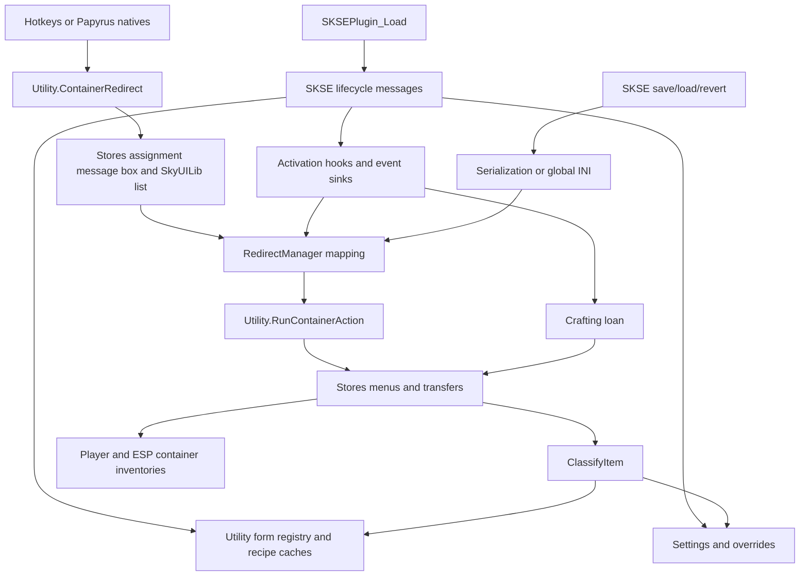

# Runtime architecture

[main.cpp](../src/main.cpp) connects SKSE lifecycle callbacks to process-wide singletons. There is no application server, database, or standalone executable. Gameplay operations use engine objects directly.

## Startup order

| Trigger | Work, in source order |
| --- | --- |
| `SKSEPlugin_Load` | Reset REL module state; obtain messaging interface; log local plugin version; initialize SKSE; allocate 128-byte trampoline; register SKSE listener; register Papyrus functions; register serialization ID and save/load/revert callbacks |
| `kPostPostLoad` | Initialize QuickLoot API; register opening-menu handler if ready, otherwise log a warning |
| `kDataLoaded` | Install translations; load companion/game forms and recipe caches; initialize settings and overrides; install hooks/event sinks; register destination menu; register optional framework UI |
| `kPostLoadGame` | Add/remove configuration spells according to settings |

Load returns false if messaging, Papyrus registration, or serialization is unavailable. Missing form lookups log errors but do not stop `LoadAllForms`; some later consumers assume those pointers exist. New-game spell provisioning is not explicitly handled by the message switch. Verify that path in-game before claiming parity with loaded saves.

## Control and data flow

## Activation and assignment

Assignment starts through the hotkey or Papyrus native, then [Utility::ContainerRedirect](../src/Utility.cpp) inspects the crosshair target. It accepts a container, or an activator with a default linked reference whose base is a container. With ownership restriction on, assignment requires an owned cell, or an exterior non-respawning container. Cell ownership means the player's actor base or a faction the player belongs to.

[Stores::VaultAssignment](../src/Stores.cpp) offers Master, Sort, Quick Transfer, grouped Vault/Archive choices, removal, and exit. Grouped choices are sorted by display name. [ContainerSelectionState](../src/ContainerMenu.cpp) retains the source smart pointer and exact displayed choices. Completion either runs a synthetic Back/Exit action or resolves the selected destination FormID and adds the mapping.

[Events.cpp](../src/Events.cpp) patches these vtable slots:

| Base type | Slot | Behavior |
| --- | --- | --- |
| `TESObjectCONT` | `0x37` | Player activation resolves a redirect and dispatches its registered action; locked containers keep original activation |
| `TESObjectACTI` | `0x37` | Player activation resolves a redirect and dispatches its action |
| Both above | `0x4C` | Call original activation-text function, then show `Search` plus destination display name for redirected crosshair target |
| `TESFurniture` | `0x37` | Lend materials before original player crafting activation when enabled and bench data is not `kNone` |

Container activation also has a thread-local guard, but the current source does not set it. Destination dispatch runs a registered `Stores` callback; it does not generically activate arbitrary redirected references. A missing action falls through to original activation. All containers registered in `Utility::LoadContainers` have actions in the current source.

[RedirectManager](../src/RedirectManager.cpp) maps source FormID to destination FormID. Add/update blocks a container linked to an activator; remove/clear unblocks it. It queues crosshair refresh after each change. The displayed name is supplied by the text hook, not persisted as part of the redirect.

## Menus and asynchronous work

Storage interaction has two UI implementations. `Stores` queues engine message boxes whose actions run through SKSE's task interface. Quick Transfer defers its completion callback until UI-managed equipment inspection has closed; its lifecycle is described in [storage.md](storage.md). `ContainerListMenu` registers as `GSCContainerListMenu`, pauses the game, uses cursor/menu input, and loads `uilib/uilib_1_listmenu` through Scaleform.

Message boxes with Exit display the physical Open action first, preserve the order of storage-specific actions, then show contextual Back and Exit. The shared builder recognizes the existing translated Open labels and maps cancellation to the final Exit. Confirmation boxes without Exit preserve their supplied order and cancel action. Armor and Weapon provide Open actions that consolidate their child archives before opening the entire parent vault.

Open Vaults and Open Archives share a registered, UI-managed SkyUILib list. The browser invokes the destination's registered action, carries contextual Back and Exit, and does not assign redirects. The former paginated vault menus are removed.

The SkyUILib bridge passes option labels as separate ActionScript arguments, configures gamepad mode, and replaces the movie's `exitMenu` callback. The callback reads `_root.listDialog.menuList.listState.activeEntry.itemIndex`, completes selection, and hides the registered menu. This movie contract is external to the repository.

`Stores::OpenStoreObject` and `CloseStoreObject` request engine open/close states. Animation polling delays 16 ms in a detached thread, then queues state inspection on the game thread. Polling uses an object handle and a five-second deadline. Timeout still invokes the callback; a vanished reference stops the poll. Keep engine access inside the queued task when modifying this path.

`OpenStorageMenu` registers one close callback for the destination, then activates that destination. The event sink only arms the callback when `ContainerMenu` opens on the matching target. On close it clears state before queuing the callback. Failed activation cancels the registration and invokes the return action. This is a single pending interaction, not a callback collection.

`RedirectedContainerState` also receives container open/close events, but its `Begin` and `Cancel` have no call sites in current first-party code. Do not infer an active second redirect lifecycle from the class name.

## Crafting loans

Enchanted equipment is selected and tagged in its archive first. Lending validates the staged physical counts and the player's signed item-count capacity, then calls the native bulk transfer once with ownership retained. Missing inventory changes or a partial/refused delivery use the existing return and archive-recovery paths. Returns remain selective by origin so carried copies and protected items retain their existing policy. Native delivery timing and arrivals after table exit still need separate investigation.

The furniture hook selects the bench through `Utility::GetBenchType`, which checks known keywords first and bench data second. `CraftingMenu` close returns materials through the same transfer helpers.

| Bench | Entry transfer | Exit transfer |
| --- | --- | --- |
| Alchemy, including grain mill keyword | Entire Alchemy inventory to player | Player items matching Alchemy to Alchemy |
| Smithing, including forge, tanning, smelter, tempering keywords | Entire Smithing inventory plus Alchemy Catalysts and banked gems present in the existing recipe caches | Smithing items/Catalysts to their parent stores; identifiable unused gem loans to Soulgem |
| Cooking | Entire Food inventory plus Alchemy Reagents to player | Food and Reagents to their parent stores |
| Enchanting | Filled gems when Crafting Loan is enabled; eligible stored equipment when Loan Enchanted Items is enabled | Unused gems to Soulgem; surviving tagged equipment to its original Weapon/Armor vault; pre-existing carried copies retained |
| Staff enchanting | Alchemy Catalysts to player | Catalysts to Alchemy |

Normal non-gem vault loans retain category-based returns and can include materials carried before the loan. Junk loans capture carried and verified moved counts and return excess to Junk before those category returns. Junk returns read only recorded loan forms; soul-gem snapshots exclude unrelated item data. Shared player deposits reject unrelated categories before fetching fresh entry data and reuse the physical transfer helper's verified moved count. Soul gems record pre-loan counts by base form and empty/filled state, plus borrowed and directly linked forms. Returns inspect current stacks, preserve pre-existing counts, and cap the returned total by the loan. Unrecognized mod transformations and ambiguous bare stacks stay on the player for explicit Quick Transfer. Consumed gems are not recreated. Both gem archives consolidate before lending.

The enchanting-equipment toggle is independent of Crafting Loan and disabled by default. The session captures the bench type and material-loan participation, returns loans even if either option changes during crafting, and rolls back after failed furniture activation. Load/new-game messages clear pending loan bookkeeping without transferring items. Bench detection, including its existing Carpenter's Workbench limitations, is unchanged. Mod filling/consumption changes are left to the installed mod; game testing remains necessary.

Ignore-list activation and recovery are described in [storage.md](storage.md). Pre-load and new-game messages cancel the pending container callback and invalidate its picker session. Post-load and new-game tasks recover picker contents on the game thread.
