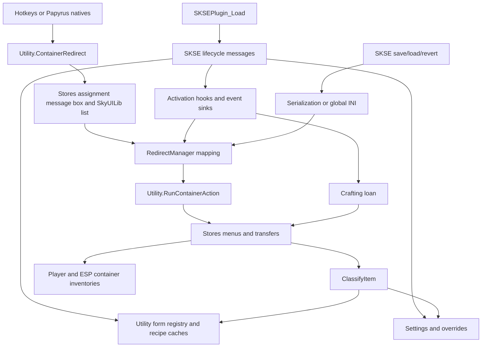

# Runtime architecture

[main.cpp](../src/main.cpp) connects SKSE lifecycle callbacks to process-wide singletons. There is no application server, database, or standalone executable. Gameplay operations use engine objects directly.

## Startup order

| Trigger | Work, in source order |
| --- | --- |
| `SKSEPlugin_Load` | Reset REL module state; obtain messaging interface; log local plugin version; initialize SKSE; allocate 128-byte trampoline; register SKSE listener; register Papyrus functions; register serialization ID and save/load/revert callbacks |
| `kPostPostLoad` | Initialize QuickLoot API; register opening-menu handler if ready, otherwise log a warning |
| `kDataLoaded` | Install translations; load companion/game forms and recipe caches; initialize settings and overrides; install hooks/event sinks; register destination menu; register optional framework UI |
| `kPostLoadGame` | Add/remove configuration spells according to settings |

Load returns false if messaging, Papyrus registration, or serialization is unavailable. Missing form lookups log errors but do not stop `LoadAllForms`; some later consumers assume those pointers exist. New-game spell provisioning is not explicitly handled by the message switch. Verify that path in-game before claiming parity with loaded saves.

## Control and data flow

## Activation and assignment

Assignment starts through the hotkey or Papyrus native, then [Utility::ContainerRedirect](../src/Utility.cpp) inspects the crosshair target. It accepts a container, or an activator with a default linked reference whose base is a container. With ownership restriction on, assignment requires an owned cell, or an exterior non-respawning container. Cell ownership means the player's actor base or a faction the player belongs to.

[Stores::VaultAssignment](../src/Stores.cpp) offers Master, Sort, grouped Vault/Archive choices, removal, and exit. Grouped choices are sorted by display name. [ContainerSelectionState](../src/ContainerMenu.cpp) retains the source smart pointer and exact displayed choices. Completion either runs a synthetic Back/Exit action or resolves the selected destination FormID and adds the mapping.

[Events.cpp](../src/Events.cpp) patches these vtable slots:

| Base type | Slot | Behavior |
| --- | --- | --- |
| `TESObjectCONT` | `0x37` | Player activation resolves a redirect and dispatches its registered action; locked containers keep original activation |
| `TESObjectACTI` | `0x37` | Player activation resolves a redirect and dispatches its action |
| Both above | `0x4C` | Call original activation-text function, then show `Search` plus destination display name for redirected crosshair target |
| `TESFurniture` | `0x37` | Lend materials before original player crafting activation when enabled and bench data is not `kNone` |

Container activation also has a thread-local guard, but the current source does not set it. Destination dispatch runs a registered `Stores` callback; it does not generically activate arbitrary redirected references. A missing action falls through to original activation. All containers registered in `Utility::LoadContainers` have actions in the current source.

[RedirectManager](../src/RedirectManager.cpp) maps source FormID to destination FormID. Add/update blocks a container linked to an activator; remove/clear unblocks it. It queues crosshair refresh after each change. The displayed name is supplied by the text hook, not persisted as part of the redirect. Comments mentioning original names are not a description of the stored structure.

## Menus and asynchronous work

Storage interaction has two UI implementations. `Stores` queues engine message boxes whose actions run through SKSE's task interface. `ContainerListMenu` registers as `GSCContainerListMenu`, pauses the game, uses cursor/menu input, and loads `uilib/uilib_1_listmenu` through Scaleform.

The SkyUILib bridge passes option labels as separate ActionScript arguments, configures gamepad mode, and replaces the movie's `exitMenu` callback. The callback reads `_root.listDialog.menuList.listState.activeEntry.itemIndex`, completes selection, and hides the registered menu. This movie contract is external to the repository.

`Stores::OpenStoreObject` and `CloseStoreObject` request engine open/close states. Animation polling delays 16 ms in a detached thread, then queues state inspection on the game thread. Polling uses an object handle and a five-second deadline. Timeout still invokes the callback; a vanished reference stops the poll. Keep engine access inside the queued task when modifying this path.

`OpenStorageMenu` registers one close callback for the destination, then activates that destination. The event sink only arms the callback when `ContainerMenu` opens on the matching target. On close it clears state before queuing the callback. Failed activation cancels the registration and invokes the return action. This is a single pending interaction, not a callback collection.

`RedirectedContainerState` also receives container open/close events, but its `Begin` and `Cancel` have no call sites in current first-party code. Do not infer an active second redirect lifecycle from the class name.

## Crafting loans

The furniture hook selects the bench through `Utility::GetBenchType`, which checks known keywords first and bench data second. `CraftingMenu` close returns materials through the same transfer helpers.

| Bench | Entry transfer | Exit transfer |
| --- | --- | --- |
| Alchemy, including grain mill keyword | Entire Alchemy inventory to player | Player items matching Alchemy to Alchemy |
| Smithing, including forge, tanning, smelter, tempering keywords | Entire Smithing inventory plus Alchemy Catalysts to player | Smithing items and Catalysts to their parent stores |
| Cooking | Entire Food inventory plus Alchemy Reagents to player | Food and Reagents to their parent stores |
| Enchanting | Entire Soulgem inventory to player | Soulgem items to Soulgem |
| Staff enchanting | Alchemy Catalysts to player | Catalysts to Alchemy |

This is category-based movement, not a ledger of borrowed stacks. Player materials matching the return categories can be deposited even if they predated the loan. Protected player inventory is skipped by `PlayerToStore`. The state holds a raw active-furniture pointer and checks the setting again on exit. Failed activation, disabling the setting mid-session, and materials stranded in archive containers need targeted verification; see [development.md](development.md).
